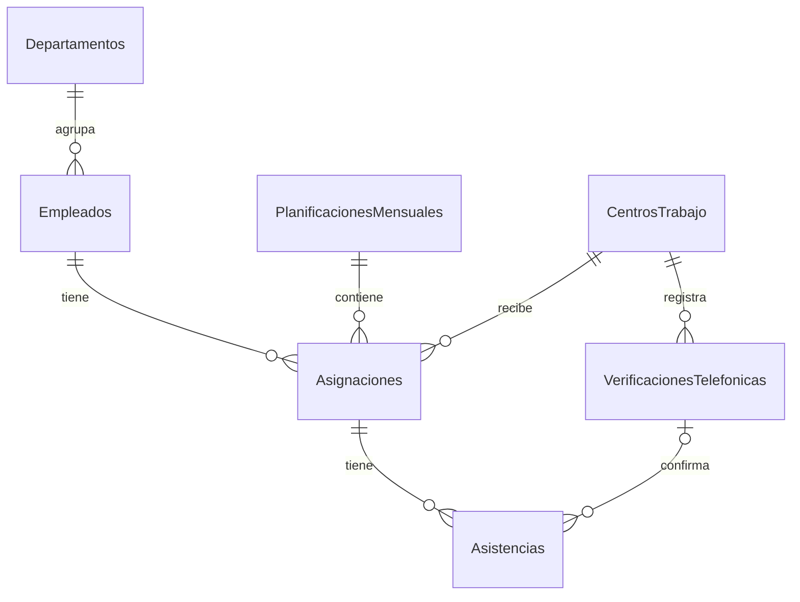

# Solución de funcionalidad de manejo de asistencia de los empleados

**Propuesto por Edgar Daniel Roblero Cisneros.**

Se propone ampliar el sistema de empleados para administrar centros de trabajo, registrar la planificación mensual de asignaciones y controlar la asistencia diaria. La asistencia será registrada por la persona responsable del proceso, con base en llamadas telefónicas a los encargados de cada centro. Cada registro permitirá identificar al empleado, la fecha, el centro de trabajo y el estado de asistencia.

Inicialmente, los registros estarán pendientes de confirmación. No se considerará ausente a un empleado únicamente porque todavía no se haya logrado contactar al encargado.

La asistencia se manejará mediante los siguientes estados:

| Estado | Significado |
| --- | --- |
| Pendiente de confirmar | Todavía no se ha corroborado la asistencia. |
| Presente | El encargado ha confirmado la asistencia del empleado. |
| Ausente | El encargado confirmó que el empleado no asistió. |

## 1. Suposiciones del diseño

- Un departamento representa el área del empleado, como Contabilidad o IT. Un centro de trabajo representa el lugar donde trabajará.
- Cada empleado tendrá asignado un único centro de trabajo durante el mes. Su asignación podrá cambiar de un mes a otro. La asistencia se registrará diariamente en el centro correspondiente a su planificación mensual.
- Cada centro tendrá un encargado y un teléfono de contacto.
- La planificación incluirá las fechas en que el empleado debe trabajar. Un día sin asignación no se considerará una ausencia.

## 2. Planificación mensual

Antes de iniciar cada mes, se registrarán las asignaciones de los empleados, indicando la fecha y el centro donde estará asignado el empleado. Ejemplo:

| Fecha | Empleado | Centro de trabajo |
| --- | --- | --- |
| 01/10/2026 | Daniel Roblero | Centro zona 9 |
| 01/10/2026 | Fernanda Estrada | Centro zona 11 |

## 3. Tablas propuestas

Se reutilizarán las tablas existentes de empleados y departamentos. Se agregarán las tablas de centros de trabajo, planificaciones mensuales, asignaciones, verificaciones telefónicas y asistencias. A continuación se detalla el conjunto de tablas:

| Tabla | Campos principales | Propósito |
| --- | --- | --- |
| centrosTrabajo | Id, código, nombre, ubicación, nombre del encargado, teléfono, estado | Registrar los centros y sus contactos. El estado indica si están activos o inactivos. |
| planificacionesMensuales | Id, año, mes, observaciones | Agrupar las asignaciones de un mes. |
| asignaciones | Id, planificaciónId, empleadoId, centroTrabajoId, observaciones | Indicar dónde debe trabajar cada empleado en cada fecha. |
| verificacionesTelefonicas | Id, centroTrabajoId, fecha de asistencia, fecha y hora de llamada, persona contactada, resultado, observaciones | Registrar los intentos de llamada y su resultado. |
| Asistencias | Id, asignacionId, fecha de asistencia, estado, motivo de ausencia, observaciones, verificacionTelefonicaId, fecha de actualización | Registrar la asistencia diaria de un empleado durante su asignación mensual. |
| Departamentos | Id, código, nombre, descripción | Registrar las áreas de la empresa a las que pertenecen los empleados. |
| Empleados | Id, código, nombres, apellidos, fechaNacimiento, departamentoId | Registrar los datos de los empleados y su departamento. |

Una planificación mensual tendrá varias asignaciones. Cada asignación corresponderá a un empleado y un centro de trabajo durante el mes, y podrá tener varios registros de asistencia, uno por cada día que deba trabajar. Una llamada podrá confirmar la asistencia de varios empleados del mismo centro para una misma fecha.

Mientras una asistencia esté pendiente, podrá no tener una llamada de confirmación asociada. Los intentos sin respuesta quedarán registrados en las verificaciones telefónicas.

### Diagrama de relaciones

Representación en Mermaid de las relaciones del diagrama del PDF. La relación con la verificación telefónica es opcional mientras la asistencia esté pendiente.

## 4. Pantallas de operación

- **Centros de trabajo:** permitirá registrar, consultar y actualizar los centros y los datos de sus encargados. Un centro que deje de utilizarse podrá desactivarse para conservar su historial.
- **Planificación mensual:** permitirá seleccionar un mes y asignar a cada empleado un centro de trabajo para todo ese período.
- **Control diario de asistencia:** mostrará los empleados asignados a un centro en una fecha. Permitirá registrar la llamada y actualizar el estado de cada empleado.
- **Consulta de asistencia:** permitirá filtrar por empleado, centro, fecha y estado, incluyendo los registros pendientes de confirmar.

## 5. Proceso de confirmación diaria

1. La persona responsable selecciona la fecha que desea verificar y consulta los empleados asignados a cada centro según la planificación del mes correspondiente.
2. Llama al encargado y registra el resultado de la llamada.
3. Si logra contactarlo, registra la asistencia de los empleados que el encargado pueda confirmar.
4. Para los empleados ausentes, registra el motivo cuando se conozca y las observaciones necesarias.
5. Si no logra contactar al encargado o este no puede confirmar algún caso, la asistencia permanece pendiente.
6. Al finalizar el día, revisa los pendientes para darles seguimiento.

El estado de asistencia y el motivo de ausencia se guardarán por separado. Una ausencia podrá tener el motivo pendiente de aclaración.

## 6. Validaciones

- El código del centro de trabajo será único.
- Solo existirá una planificación para cada combinación de año y mes.
- No se permitirá asignar al mismo empleado más de una vez dentro de una planificación mensual.
- Solo se permitirá realizar nuevas asignaciones a centros activos.
- Cada asignación podrá tener varios registros de asistencia, pero solo uno por fecha.
- La fecha de asistencia deberá pertenecer al mes y año de la planificación asociada.
- Para marcar presente o ausente, deberá existir una confirmación telefónica del centro y de la fecha de asistencia correspondientes.
- Una llamada sin respuesta no cambiará automáticamente el estado a ausente.
- No se permitirá eliminar centros o asignaciones que tengan asistencia confirmada.
- No se permitirá cambiar el empleado o el centro de una asignación que ya tenga asistencia confirmada, para conservar la correspondencia histórica.
- Las correcciones de asistencia deberán incluir una observación con el motivo del cambio.

## 7. Consultas que se realizarían al encargado del proceso

- ¿Qué procedimiento se sigue cuando no responde el encargado?
- ¿Cómo comprueba el encargado que el empleado está presente?
- ¿La asignación a un centro se mantiene durante todo el mes o pueden existir cambios de centro dentro del mismo mes?
